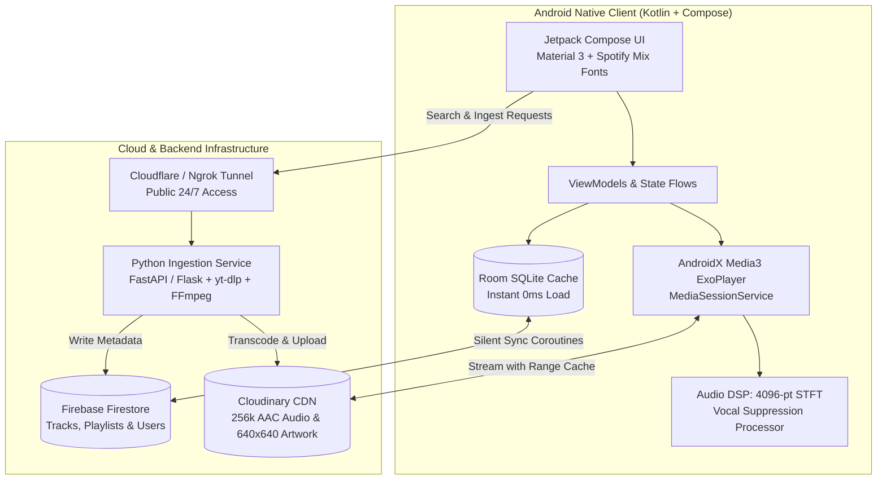

<div align="center">

  

  # Spotify Native Android
  
  **A flagship native Android music streaming client engineered with Kotlin, Jetpack Compose, AndroidX Media3, and Real-Time STFT Audio DSP.**

  [](https://kotlinlang.org/)
  [-3DDC84?style=for-the-badge&logo=android&logoColor=white)](https://developer.android.com)
  [](https://developer.android.com/jetpack/compose)
  [](https://developer.android.com/guide/topics/media/media3)
  [](https://firebase.google.com/)
  [](https://developer.android.com/training/data-storage/room)
  [](LICENSE)

  <p align="center">
    <a href="#-key-features">Key Features</a> •
    <a href="#-system-architecture">Architecture</a> •
    <a href="#-tech-stack">Tech Stack</a> •
    <a href="#-getting-started">Getting Started</a> •
    <a href="#-backend-ingestion-pipeline">Backend Pipeline</a> •
    <a href="#-security--credentials">Security</a>
  </p>

</div>

---

## 🌟 Overview

**Spotify Native Android** is a high-performance, commercial-grade native Android streaming application designed for **buttery-smooth 120Hz display refresh rates**, **instant 0-latency playback transitions**, and **immersive audiovisual acoustics**.

Built entirely from scratch utilizing modern Android engineering standards, it features **real-time vocal suppression (Apple Sing / Karaoke mode)** using an onboard 4096-point Short-Time Fourier Transform (STFT) audio processor, **GPU-accelerated dynamic fluid mesh gradients** rendered from cover artwork palettes, and an **offline-first Room SQLite caching layer** for instant zero-reload browsing.

---

## 🚀 Key Features

### 🎧 1. Next-Gen Audio Pipeline & Real-Time DSP
* **AndroidX Media3 ExoPlayer Engine:** Background playback handled by a robust `MediaSessionService` with complete Android system lockscreen & notification media controls, audio focus handling, and automatic ducking.
* **Real-Time Vocal Suppression (Apple Sing / Karaoke):** Custom `VocalSuppressionAudioProcessor` injected directly into ExoPlayer's audio graph. Computes 4096-point Short-Time Fourier Transforms (STFT) to isolate and eliminate center-panned vocal frequencies dynamically without latency.
* **Instant Range Caching:** High-speed OkHttp data source streaming from Cloudinary CDN with intelligent chunk pre-caching.

### 🎨 2. Fluid Motion UI & Convx Visuals
* **Dynamic Fluid Mesh Backdrop:** Real-time color extraction from album artwork via `androidx.palette`, feeding an animated GPU fluid orbital gradient shader for mesmerizing visual depth.
* **Spotify Mix Typography:** Styled using the authentic Spotify Mix typeface family (`Spotify Mix Regular`, `Bold`, `Title Bold`, and `Mono`).
* **Rolling Tabular Time:** Micro-animated playback timers that smoothly transition digits with zero layout shift or horizontal jumping.
* **Interactive Player Sheet:** Gesture-driven expandable bottom sheet with spring physics, quick action controls, repeat/shuffle modes, and sleep timer.

### ⚡ 3. Offline-First "Zero-Reload" Architecture
* **Instant SQLite Room Cache:** Tracks, albums, and playlists load with 0ms delay directly from local Room persistence.
* **Silent Reactive Sync:** Real-time Firestore synchronization runs silently on background coroutines with non-blocking UI invalidation.
* **Smart Duplicate Resolver:** Built-in Levenshtein distance and duration matcher (`SongDuplicateMatcher`) detects and merges duplicate tracks across collections.

### 📥 4. High-Throughput Media Ingestion Engine
* **Automated Audio Ingestion:** Python backend powered by `yt-dlp` VisionOS emulation retrieving pristine 256k AAC streams.
* **Metadata & Cover Enhancement:** Automated pipeline query against Apple Music / Shazam for studio-master 640x640 album artwork and canonical ID3 tags.
* **Global Access & Tunneling:** Runs seamlessly on desktop, home server, or mobile Termux with automated Cloudflare/Ngrok tunneling.

---

## 🏗️ System Architecture



---

## 🛠️ Tech Stack

| Category | Technologies / Libraries |
| :--- | :--- |
| **Language** | Kotlin 2.0.20 (100% Kotlin) |
| **UI Framework** | Jetpack Compose (BOM 2024.10.00), Material 3 |
| **Audio Engine** | AndroidX Media3 1.4.1 (ExoPlayer, MediaSession, OkHttp DataSource) |
| **Audio DSP** | Custom 4096-pt STFT Phase-Vocoder Vocal Attenuation |
| **Local Storage** | AndroidX Room 2.6.1 SQLite Database (with KSP compiler) |
| **Cloud Services** | Firebase (Firestore, Auth, Storage), Cloudinary Media CDN |
| **Image Loading** | Coil 3.0.4 with OkHttp Network Layer |
| **Aesthetics** | AndroidX Palette KTX, Lottie Compose, Spotify Mix Typography |
| **Backend & Tools** | Python 3.11+, yt-dlp, FFmpeg, Cloudflare Tunnel, Ngrok |

---

## 📂 Project Structure

```
Spotify_Native_Android/
├── app/
│   ├── build.gradle.kts                # App-level dependencies & compiler flags
│   ├── google-services.json.example    # Firebase configuration template
│   ├── proguard-rules.pro              # Code obfuscation & optimization rules
│   └── src/main/
│       ├── AndroidManifest.xml         # Android permissions & foreground service
│       ├── kotlin/com/example/spotify_clone/
│       │   ├── MainActivity.kt         # Single-activity Compose entry point
│       │   ├── SpotifyApp.kt           # Navigation graph & composition root
│       │   ├── data/
│       │   │   ├── local/              # Room Database, DAOs, and Entities
│       │   │   ├── models/             # Song, Playlist, and User Domain models
│       │   │   └── remote/             # Firebase repository & Ingestion HTTP client
│       │   ├── playback/
│       │   │   ├── MediaPlaybackService.kt  # Foreground MediaSession playback service
│       │   │   ├── PlayerConnection.kt      # Controller binding UI to Media3 player
│       │   │   └── audio/              # STFT Vocal Suppression Audio Processor
│       │   ├── ui/
│       │   │   ├── components/         # MiniPlayer, PlayerBottomSheet, Dialogs
│       │   │   ├── screens/            # Home, Search, Library, Ingestion, Album
│       │   │   └── theme/              # SpotifyColors, SpotifyMix typography, PaletteHelper
│       │   └── utils/                  # Song duplicate matcher & sorting utilities
│       └── res/                        # Drawables, Spotify Mix fonts, icons, Lottie animations
├── assets/                             # Brand assets, fonts, and animation specs
├── cloud_functions/                    # Python audio ingestion service & metadata scripts
│   ├── main.py                         # High-performance audio download & transcode API
│   ├── fix_existing_covers.py          # High-resolution artwork upgrade automation
│   ├── requirements.txt                # Python backend dependencies
│   ├── README_DEPLOY.md                # 24/7 PC & Termux server deployment guide
│   └── .env.example                    # Backend environment variable template
├── database/                           # Database migration & export scripts
│   ├── firebase-key.json.example       # Firebase Admin SDK credentials template
│   └── edits/                          # CSV export/import & batch maintenance scripts
├── build.gradle.kts                    # Root Gradle build script
├── settings.gradle.kts                 # Project repositories and plugin management
└── README.md                           # Project documentation
```

---

## 🚦 Getting Started

### 📋 Prerequisites
* **Android Studio Ladybug (2024.2+)** or newer
* **JDK 17** configured in Android Studio Gradle settings
* **Android SDK 35** (Minimum SDK supported: Android 8.0 / API 26)
* A physical Android device or emulator with Google Play Services

### ⚙️ Installation & Setup

#### 1. Clone the Repository
```bash
git clone https://github.com/JoyalJose54/Spotify_Native_Android.git
cd Spotify_Native_Android
```

#### 2. Configure Firebase
1. Navigate to your [Firebase Console](https://console.firebase.google.com/) and create a new project.
2. Add an Android app with the package name:
   ```
   com.example.spotify_clone
   ```
3. Download the generated `google-services.json` file.
4. Place it inside the `app/` directory:
   ```bash
   cp /path/to/downloaded/google-services.json app/google-services.json
   ```
   *(A reference template is provided at `app/google-services.json.example`)*

#### 3. Build & Run
Open the project directory in Android Studio:
```bash
# Or build directly via Gradle command line:
./gradlew installDebug
```

---

## ⚙️ Backend Ingestion Pipeline

The project includes an ingestion backend located in `cloud_functions/` to transcode, tag, and stream audio:

1. **Navigate to the backend directory:**
   ```bash
   cd cloud_functions
   ```
2. **Install Python dependencies:**
   ```bash
   pip install -r requirements.txt
   ```
3. **Configure Environment Variables:**
   ```bash
   cp .env.example .env
   ```
   Provide your Cloudinary credentials and Firebase Admin private key path:
   ```ini
   CLOUDINARY_CLOUD_NAME=your_cloud_name
   CLOUDINARY_API_KEY=your_api_key
   CLOUDINARY_API_SECRET=your_api_secret
   FIREBASE_CREDENTIALS_JSON=../database/firebase-key.json
   ```
4. **Start the Backend:**
   * **Windows Quick Start:** Double-click `run_ngrok_backend.bat` or `run_backend.bat`.
   * **Linux / macOS:** Run `./start.sh` or `python main.py`.
   * **24/7 Mobile Termux Deployment:** See [cloud_functions/README_DEPLOY.md](cloud_functions/README_DEPLOY.md).

---

## 🔐 Security & Credentials

This repository follows standard security practices:
* **Zero Hardcoded Secrets:** Private API tokens, service account certificates, and environment secrets are excluded via `.gitignore`.
* **Example Templates:** Every secret configuration contains a corresponding `.example` file (`google-services.json.example`, `firebase-key.json.example`, `.env.example`).
* **Never commit:**
  * `google-services.json`
  * `firebase-key.json`
  * `.env`
  * `*.keystore` / `*.jks`
  * `yt_cookies.txt`

---

## 🤝 Contributing

Contributions, feedback, and pull requests are welcome!
1. Fork the Project
2. Create your Feature Branch (`git checkout -b feature/AmazingFeature`)
3. Commit your Changes (`git commit -m 'Add some AmazingFeature'`)
4. Push to the Branch (`git push origin feature/AmazingFeature`)
5. Open a Pull Request

---

## 📄 License

This project is licensed under the Apache License 2.0. See the [LICENSE](LICENSE) file for details.

<div align="center">
  <sub>Crafted for pure musical performance & native fluidity.</sub>
</div>
